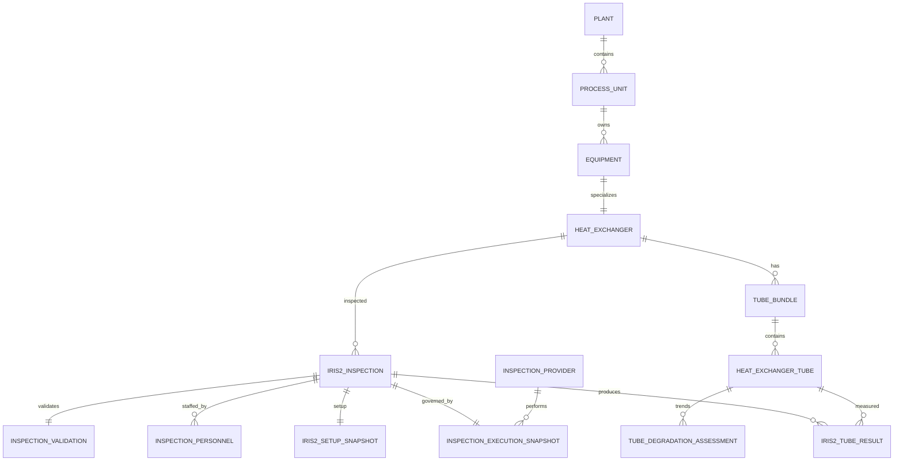

# IRIS Heat Exchanger DB Layout

## 조직 코드 관리 적용 — 2026-10-04 / Schema 3.14.0

현재 코드와 운영 DB 버전은 **3.14.0**이다. 아래 3.13.0 기준 기록은 조직 코드 관리 적용 전의 기록으로 보존한다.

- `organization_code` 테이블에서 `PLANT`(공장) → `TEAM`(생산팀) → `PROCESS`(공정)을 `parent_id`로 연결한다.
- 각 코드는 `code`, `label`(화면 표시명), `description`(상세 설명)을 관리한다. 동일 상위 조직 안에서 코드는 중복할 수 없다.
- 기존 공장 코드는 유지하며 `P1`의 기본 Label과 `plant.plant_name`을 **울산공장**으로 반영했다.
- 운영 DB 초기 등록: 공장 2개, 생산팀 5개, 공정 관계 40개(원문 공정명 39종). 기존 설비 900개의 생산팀·공정이 모두 매핑된다.
- 메뉴: **기본 설정 → 조직 코드 관리**, 경로 `/master-data/organization-codes`.
- 코드 등록과 Label·상세 설명 수정, 상위 조직 선택, 검색, 연결 설비 수 조회를 지원한다. 기존 `PLANT_LINES` 화면 권한과 CSRF 보호를 적용한다.
- 등록 후 코드와 상위 조직은 고정하고 Label을 수정한다. Label 변경은 공장·생산팀·공정을 표시하는 열교환기 목록·상세·수정 화면과 주요 설비 조회 화면에 반영된다.
- 열교환기 목록에 생산팀·공정 필터를 추가했다. 열교환기 등록·수정 시 조직 공정을 선택하면 `equipment.production_team_code`, `equipment.process_code`를 함께 저장하며 공장 일치를 검증한다.
- 기존 `process_unit`, `equipment.unit_id`, 검사 캠페인 연결은 유지한다. 기존 검사 분류 필터는 신규 조직 필터와 별도로 유지한다.
- 생성 시 기존 공장·설비 코드에서 누락된 조직 코드를 등록하며, 사용자가 수정한 Label은 초기화하지 않는다.
- 조직 코드 적용 전 백업: `backups/before_organization_codes_20261004_070323.db`.
- 적용 후 확인: 기존 설비 902개의 검사 연결·생산팀·공정·설치일 동일, 조직 매핑 누락 0건, DB 무결성 `ok`, 외래키 오류 0건.
- 검증: 조직 계층·중복·Label 반영·초기화 후 Label 유지·공장 불일치 롤백·화면 권한·CSRF 및 기존 주요 화면·정렬·QR·Excel 내보내기 관련 테스트 11개 통과. 브라우저에서 공정 상위 조직 선택과 코드 검색, 울산공장 표시를 확인했다.
- 운영 서버를 기존 `server.py --no-browser` 옵션으로 재시작했다. `http://127.0.0.1:4823/api/health` 응답 200 및 스키마 3.14.0을 확인했으며, 코드 관리 경로는 정상적으로 로그인 화면으로 연결된다.

## 조직 코드 적용 전 DB 기준 — 2026-10-04 / Schema 3.13.0 (Asia/Seoul)

이 절은 2026-10-03 반영 사항을 포함하여 2026-10-04에 실제 DB를 조회한 기준 기록이다.
아래 과거 버전 설명과 다른 항목은 이 절의 현재 기준을 따른다.

- 운영 파일: `data/heat_exchanger_db3.db`
- 코드의 `SCHEMA_VERSION` 및 DB의 최신 `schema_version.version`: **3.13.0**
- 이번 상태·날짜 정리 및 생산팀·공정 필드 추가는 적용되었으나 별도 버전 번호는 아직 부여하지 않았다. 따라서 같은 3.13.0 표기만으로 이전 DB와 구조가 동일하다고 판단하면 안 된다.

### 튜브 상태와 날짜

| 항목 | 현재 기준 |
| --- | --- |
| 운전 상태 | `IN_SERVICE`(사용 중), `PLUGGED`(폐쇄) 두 가지 |
| 기존 `UNUSED` | 사용 중으로 통합; 기존 1개 변경 및 전환 이력 보존 |
| 개별 튜브 설치일 | `heat_exchanger_tube.installed_at`; 해당 열교환기의 `equipment.install_date`와 동일한 값으로 일괄 반영 |
| Plugging date | `heat_exchanger_tube.plugging_date`; 개별 튜브의 기존 `retired_at`을 이름 변경하여 사용 |
| 운전 상태 변경일시 | `tube_lifecycle_event.event_date` 삭제; 변경 내용과 사유는 유지 |
| 튜브 위치 변경일시 | `tube_position_event.event_date` 삭제; 위치 변경 내용과 사유는 유지 |
| 튜브 번들 설치일 | `tube_bundle.installed_at` 삭제; 해당 입력·표시 및 이에 의존하던 번들 교체일 표시 제거 |

개별 튜브 Plugging date와 번들의 `tube_bundle.retired_at`은 별개이다. 번들 퇴역 필드는 유지한다.
Plugging date는 상태 저장 시각으로 자동 채우지 않는다. 현재 화면에서는 조회 항목이며 날짜 입력 기능은 없다.
튜브 설치일 반영은 일괄 업데이트 결과이며, 이후 열교환기 설치일 변경이나 신규 튜브 생성 시 자동 동기화를 구현한 것은 아니다.

### 공장·생산팀·공정 및 설치일 원본

원본: `C:/access/hanhwa/IRIS2_DATA/Master_HeatExchanger_Team_process_install.xlsx`, 시트 `2026102`, 데이터 행 3–902.
원본 SHA-256: `f39b80d7d5fa21c1cfd3383df3558646249badbc5e302345f501001278d9c21a`.
설비코드(C열)와 설비 Tag(F열)를 함께 검증하여 기존 설비 900개에 반영했다.

| 항목 | 원본 및 DB 반영 기준 |
| --- | --- |
| 공장 | 기존 `plant.plant_code`와 설비의 공장 연결 유지; 원본 대상 900개는 모두 `P1` |
| 생산팀 | D열 → `equipment.production_team_code` |
| 공정 | E열 → `equipment.process_code` |
| 열교환기 설치일 | I열 → `equipment.install_date` |
| 개별 튜브 설치일 | 위 설치일을 번들·열교환기 관계로 연결해 `heat_exchanger_tube.installed_at`에 반영 |

생산팀은 `PE`, `VCM`, `PVC1`, `PVC2`, `가소제` 5종, 공정은 원문 기준 39종이다.
생산팀·공정 조합은 40종으로, 동일 공정명이 여러 생산팀에 속할 수 있으므로 두 필드를 함께 사용한다.
기존 `equipment.unit_id` 및 `process_unit` 연결은 검사 캠페인 등 기존 기능을 위해 유지했다.
기존 화면의 분류·필터와 내보내기를 새 생산팀·공정 필드로 전환하는 작업은 아직 수행하지 않았다.
원본에 없는 설비 `E-LINE-A-001`, `E-TEST-V21`은 이번 엑셀 반영 대상에서 제외했다.

### 확인 결과와 복구 자료

2026-10-04 조회 결과:

- 설비 902개 중 원본 900개에 생산팀·공정 반영; 매칭 오류 0건.
- 생산팀별 원본 설비 수: PE 191개, VCM 212개, PVC1 190개, PVC2 148개, 가소제 159개.
- 튜브 2,253개 모두 `IN_SERVICE`; `PLUGGED` 0개.
- 튜브 설치일 입력 2,253개; 열교환기 설치일과 불일치 0개.
- Plugging date 입력 0개.
- SQLite `integrity_check`: `ok`. 각 반영 시 외래키 검사 오류 0건.
- 상태·Excel 내보내기·튜브맵·마스터 필수 입력 등 변경 관련 테스트 통과.

반영 전 백업:

- `backups/tube_status_two_states_20261003_202152.db`
- `backups/tube_date_cleanup_20261003_203956.db`
- `backups/before_installation_date_import_20261003_205723.db`
- `backups/before_team_process_import_20261003_211036.db`

설치일 및 생산팀·공정 반영 상세 기록:

- `outputs/installation_date_import_20261003_205723/audit.json`
- `outputs/team_process_import_20261003_211036/audit.json`

## Schema 3.7.0 additions

`heat_exchanger_spec_revision.exchanger_code` is initially copied from
`equipment.equipment_code`, then retained as the stable exchanger/Item No.
identifier. Asset equipment-code changes do not overwrite it, and new revisions
inherit the previous exchanger code automatically.

Identity rules after the Master_head mapping are:

- `equipment.equipment_code`: numeric asset code from `Master_head.csv` (`설비코드`)
- `heat_exchanger_spec_revision.exchanger_code`: process Item No. (`교환기코드`, for example `E-141A`)
- Master matching key: `(process_unit.unit_code, exchanger_code)`
- IRIS report matching: current `exchanger_code`, then only explicitly approved legacy aliases

## Schema 3.6.0 additions

JSON document loading and post-processing are tracked independently in
`source_document` using `load_status`, expected/loaded/missing report counts,
`postprocess_status`, and `postprocess_message`. A `PARTIAL` document can be
retried after Master data is completed without creating a duplicate document.

## Schema 3.5.0 additions

Report process context is stored in `iris_setup_snapshot` using `process_code`,
`production_line`, `shell_fluid`, `tube_fluid`, and `tube_type`.

Inspection-company provenance is stored in `inspection_execution_snapshot`
using `inspection_company_source_text`, `inspection_company_brand`, and
`source_page`.

## Schema 3.4.0 additions

Year-only installation/replacement values are preserved without inventing a
month or day:

- `iris_inspection.installation_or_replacement_date_raw`
- `iris_inspection.installation_or_replacement_year`
- `iris_inspection.installation_or_replacement_date_precision` (`DAY`, `MONTH`, `YEAR`, `UNPARSED`)

IRIS tube-result source details are queryable in dedicated columns:

- `iris_tube_result.location_source_unit`
- `iris_tube_result.remark`
- `iris_tube_result.design_wall_thickness_mm`
- `iris_tube_result.defect_code`
- `iris_tube_result.reported_depth_percent`

- 문서 버전: 3.7.0
- 기준일: 2026-08-16
- DB: `iris/data/heat_exchanger_db3.db`
- 설정: `iris/hx_configuration.conf`
- ORM 정의: `iris/iris_v2_models.py`
- 마이그레이션: `iris/iris_v2_database.py`
- 기준 전체 DDL: `iris/docs/schema_v3_6.sql`
- 현재 마이그레이션: `iris/docs/migration_v3_11.sql`

### 검사계획 3.10

- 검사일정은 `inspection_plan_v2`에서 교환기 단위로 관리한다.
- 신규 일정은 `requested_by_user_id`에 신청자를 기록하고, 관리자 승인 시
  `approved_by_user_id`, `approval_date`, `target_locked_at`을 기록한다.
- `inspection_plan_tube_target`에는 일정 등록 시 선택한 `IN_SERVICE` Tube와
  Tube 번호·Row/Column·Bundle·상태 Snapshot을 저장한다.
- Tube별 진행상태는 `TARGETED`, `INSPECTED`, `EXCLUDED`로 관리하며 제외 시
  사유를 필수로 기록한다.
- `inspection_plan_event`는 등록, 승인, 검사 시작, Tube 처리, 검사 완료 및
  취소 이력을 처리자와 함께 보존한다.
- 3.11부터 과거 완료 계획은 `completed_inspection_id`의 실제
  `iris_tube_result`만 대상 Tube로 백필하고 `source_iris_tube_result_id`로
  원본 결과를 추적한다. 결과가 없는 Tube는 검사제외로 추정하지 않는다.
- 현재 마이그레이션: `iris/docs/migration_v3_10.sql`

## 1. 설계 원칙

1. 설비 마스터와 검사 당시 스냅샷을 분리한다.
2. 원본 JSON은 변경하지 않고 구조화된 운영 필드만 정정·보완한다.
3. 검사 수행업체는 재사용 가능한 마스터로 관리한다.
4. 계약·절차서·소프트웨어·교정 정보는 검사별 스냅샷으로 보존한다.
5. 장비 제조사와 검사 수행업체를 같은 개념으로 사용하지 않는다.
6. `customer`와 `owner_customer`는 발주자/설비 소유자이며 검사 수행업체가 아니다.

## 2. 핵심 관계

## 3. 검사 수행정보 신규 구조

### 3.1 `inspection_provider`

검사 수행회사 마스터다. 장비 제조사, 발주자 및 설비 소유자와 구분한다.

| 필드 | 의미 | 관리 기준 |
|---|---|---|
| `inspection_provider_id` | PK | 시스템 생성 |
| `provider_code` | 업체 코드 | 필수·고유 |
| `provider_name` | 업체명 | 필수 |
| `business_registration_no` | 사업자번호 | 확인된 값만 입력 |
| `contact_name` | 담당자 | 선택 |
| `contact_phone` | 연락처 | 선택 |
| `contact_email` | 이메일 | 선택 |
| `is_active` | 사용 여부 | 기본 true |
| `remarks` | 비고 | 업체 변경이력 등 |

### 3.2 `inspection_execution_snapshot`

검사 당시의 수행업체·계약·절차·소프트웨어·교정정보를 저장한다. 동일 업체라도 검사마다 소프트웨어 버전과 교정상태가 다를 수 있으므로 마스터가 아닌 스냅샷이다.

| 필드 | 의미 |
|---|---|
| `iris_inspection_id` | 검사 FK, 검사당 1건 |
| `inspection_provider_id` | 수행업체 마스터 FK |
| `inspection_company_raw` | 원보고 업체명 원문 |
| `contract_no` | 검사 계약번호 |
| `work_order_no` | 작업지시번호 |
| `procedure_no` | 검사 절차서 번호 |
| `procedure_revision` | 절차서 개정번호 |
| `acquisition_software_name` | 데이터 취득 소프트웨어 |
| `acquisition_software_version` | 취득 SW 버전 |
| `analysis_software_name` | 분석·판독 소프트웨어 |
| `analysis_software_version` | 분석 SW 버전 |
| `equipment_calibration_date` | 장비 교정일 |
| `equipment_calibration_valid_until` | 교정 유효기간 |
| `remarks` | 검사 수행 참고사항 |
| `raw_json` | 원본에서 추출한 관련 구조 보존 |

### 3.3 `iris_setup_snapshot`

검사장비와 측정조건을 검사 당시 값으로 저장한다.

| 영역 | 주요 필드 |
|---|---|
| 장비 | `equipment_maker`, `equipment_model`, `equipment_serial_number` |
| 탐촉자 | `search_unit_maker`, `search_unit_model`, `search_unit_serial_number` |
| 측정 | `frequency_mhz`, `material_velocity_meter_per_sec`, `scan_velocity_meter_per_min` |
| 환경 | `water_pressure_kg_per_cm2`, `water_temperature_celsius` |
| 치수 | `out_diameter_mm`, `tube_length_m` |

`equipment_model`에 `IRIS 9000 V4.0`처럼 버전 문자가 포함되어 있어도 이를 분석 소프트웨어 버전으로 자동 변환하지 않는다.

### 3.4 `inspection_personnel`

검사자, 판독자, 작성자, 입회자 정보를 저장한다.

| 필드 | 의미 |
|---|---|
| `role` | `EXAMINER`, `INTERPRETER`, `PREPARED_BY`, `WITNESSER` 등 |
| `person_name` | 성명 |
| `organization` | 소속 회사/조직 |

사람의 소속과 검사 수행업체가 다를 수 있으므로 `organization`과 `inspection_provider_id`를 별도로 관리한다.

## 4. 전체 테이블 그룹

### 기준정보·권한

- `app_user`
- `user_screen_permission`
- `wall_loss_color_setting`
- `schema_version`
- `schema_table_dictionary`
- `schema_field_dictionary`

### 공장·설비 마스터

- `plant`
- `process_unit`
- `equipment`
- `equipment_alias`
- `heat_exchanger`
- `heat_exchanger_spec_revision`
- `heat_exchanger_side_spec`
- `heat_exchanger_capacity`
- `heat_exchanger_compliance`
- `heat_exchanger_management_criteria`
- `master_heat_exchanger_staging`

### 튜브 마스터·생애주기

- `tube_bundle`
- `heat_exchanger_tube`
- `tube_lifecycle_event`
- `tube_position_event`

### 검사 원본·적재

- `import_batch`
- `source_document`
- `inspection_campaign`
- `inspection_scope`
- `inspection_scope_direction`
- `inspection_source_page`

### 검사 수행·장비·인원

- `inspection_provider`
- `inspection_execution_snapshot`
- `iris_setup_snapshot`
- `inspection_personnel`

### IRIS 검사결과

- `iris_inspection`
- `iris_inspection_spec_snapshot`
- `iris_representative_assessment`
- `iris_recommendation`
- `iris_tube_map`
- `iris_tube_map_legend`
- `iris_tube_result`
- `iris_indication`
- `inspection_validation`
- `data_quality_issue`

### 추세·정비·계획

- `tube_degradation_assessment`
- `inspection_plan_v2`
- `work_order_v2`
- `maintenance_record`

## 5. 데이터 입력 및 보완 기준

### 필수 확인

- 수행업체명은 계약서, 작업지시서 또는 원본 검사보고서에서 확인한다.
- 취득·분석 소프트웨어는 제품명과 버전을 분리 입력한다.
- 장비와 탐촉자는 각각 제조사·모델·일련번호를 입력한다.
- 교정 유효기간이 검사일보다 빠르면 품질이슈로 검토한다.
- 검사자 소속은 수행업체와 같다고 추정하지 않는다.

### 입력 금지

- `customer` 또는 `owner_customer`를 검사 수행업체로 자동 복사하지 않는다.
- `Eddyfi`, `IRIS-INSPECTION INC` 같은 장비 제조사를 수행업체로 자동 지정하지 않는다.
- 장비 모델의 `V4.0`, `V5.0`을 소프트웨어 버전으로 자동 지정하지 않는다.
- 근거가 없는 회사명·버전·교정일을 추정 입력하지 않는다.

## 6. 기존 데이터 백필 정책

스키마 3.2.0 적용 시 원본 `iris_inspection.raw_report_json`에서 다음 항목을 구조화 테이블로 안전하게 복원한다.

- 장비 제조사·모델·일련번호
- 탐촉자 제조사·모델·일련번호
- 주파수와 측정조건
- 검사자·판독자·작성자·입회자 이름
- 원본에 명시된 경우에만 수행업체·소프트웨어·절차·교정정보

원본에 없는 수행업체와 소프트웨어 정보는 빈 값으로 유지하며 UI에서 근거 확인 후 입력한다.

## 7. 운영 화면

검사 상세 화면 `/inspections/{inspection_id}`의 `검사 수행업체·장비·소프트웨어` 영역에서 관리한다.

- 기존 수행업체 선택
- 신규 수행업체 코드·이름 생성
- 계약·작업지시·절차서 입력
- 취득/분석 소프트웨어와 버전 입력
- 교정일과 유효기간 입력
- 장비·탐촉자 식별정보 입력
- 검사자·판독자·작성자 소속 입력

## 8. 참고사항

- 원본 JSON은 감사 증적으로 유지하며 UI 수정으로 덮어쓰지 않는다.
- 정정값은 구조화된 운영 컬럼에 저장한다.
- 수행업체 변경은 과거 검사 스냅샷을 변경하지 않는다.
- 미확인 값은 `UNKNOWN` 문자열보다 NULL을 사용한다.
- 보고서 출력 시 수행업체, 소프트웨어, 장비 일련번호, 교정 유효상태를 함께 표시하는 것을 권장한다.
- 향후 품질규칙으로 `교정 만료`, `소프트웨어 버전 누락`, `검사자 소속 누락`을 추가할 수 있다.

### 설치 이전 검사이력의 사용 기준 (2026-10-23)

설치일보다 이른 검사자료는 정상적인 과거 조회 자료이며 데이터 오류가 아니다. 원본 날짜·측정값을 수정하거나 삭제하지 않는다. 현재 설치분의 감육 순위·잔여수명·재검사 비교에는 장비와 Tube의 현재 설치일 중 늦은 날짜 이후의 자료만 사용한다. 같은 날짜는 현재 설치분으로 포함하며, 경과시간이 없는 부식속도는 산정하지 않는다. 설치 이전 자료는 Tube 이력 화면에 조회 전용으로 표시한다.
