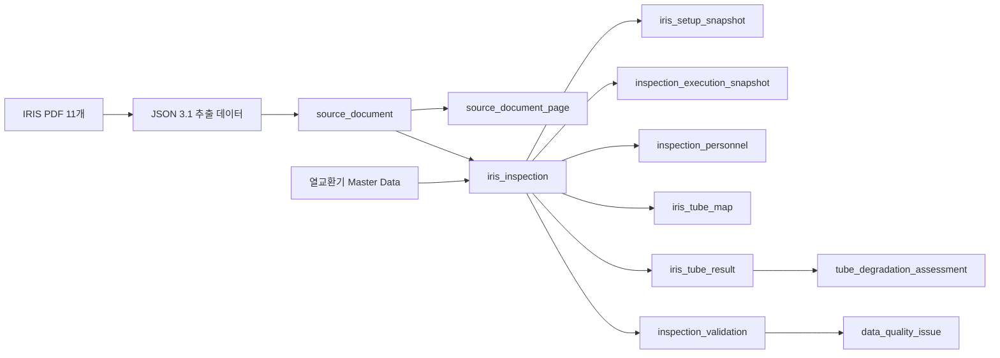

# IRIS DB Layout, Master Data 및 JSON 적재 정리

## 1. 문서 개요

- 작성 기준일: 2026-08-16
- 대상 DB: `C:\access\heat\iris2\data\heat_exchanger_v3.db`
- DB 엔진: SQLite
- 최초 적재 스키마 버전: `3.5.0`
- 현재 운영 스키마 버전: `3.6.0` (부분 적재·후처리 상태 및 보안 리뷰 개선 반영)
- JSON 위치: `C:\access\hanhwa\IRIS2_DATA\extracted_json_complete_20260816`
- JSON 문서 수: 11개
- DB 무결성 검사: `ok`
- 외래키 위반: 0건

이 문서는 열교환기 Master Data, IRIS 검사 JSON 적재 구조, 주요 테이블 관계,
장비 식별 정규화 규칙 및 최종 적재 결과를 정리한다.

## 2. 전체 데이터 흐름

적재 시 기존 `iris_inspection_id`를 유지하는 upsert 방식을 사용한다. 따라서 기존
검사계획, 튜브 이력 및 검사 참조 관계가 끊어지지 않는다.

## 3. DB Layout

### 3.1 공장 및 설비 Master

| 테이블 | 역할 | 현재 건수 |
|---|---|---:|
| `plant` | 공장 Master | 1 |
| `process_unit` | 공정/생산 Unit Master | 6 |
| `equipment` | 설비 기본 Master | 900 |
| `heat_exchanger` | 열교환기 관리 Master | 900 |
| `equipment_alias` | 원문 장비명 및 과거 장비명 별칭 | 200 |
| `heat_exchanger_spec_revision` | 열교환기 사양 Revision | 1,047 |
| `heat_exchanger_side_spec` | Shell/Tube Side 사양 | 2,202 |
| `heat_exchanger_capacity` | 용량 데이터 | 1,189 |
| `heat_exchanger_compliance` | 법정검사 및 규정 정보 | 900 |
| `heat_exchanger_management_criteria` | 관리 기준 | 900 |
| `tube_bundle` | 열교환기 Bundle | 259 |
| `inspection_scope` | TOP, BTM, NORTH, FRONT 등 검사 범위 | 205 |
| `inspection_scope_direction` | 복합 방향 구성 | 97 |
| `heat_exchanger_tube` | 튜브 위치 Master | 2,251 |

### 3.2 원본 문서 및 적재 이력

| 테이블 | 역할 | 현재 건수 |
|---|---|---:|
| `import_batch` | JSON 적재 Batch 이력 | 15 |
| `source_document` | JSON/PDF 문서 단위 원본 정보 | 11 |
| `source_document_page` | PDF 페이지별 텍스트·이미지·분류 정보 | 2,456 |
| `inspection_campaign` | 연도 및 Unit별 검사 Campaign | 11 |

`source_document.document_json`, `source_document.schema_json`,
`source_document_page.raw_json`을 통해 추출 원문을 손실 없이 보존한다.

### 3.3 검사 보고서 및 수행 정보

| 테이블 | 역할 | 현재 건수 |
|---|---|---:|
| `iris_inspection` | 검사 보고서 Header | 435 |
| `iris_inspection_spec_snapshot` | 검사 당시 튜브 사양과 Summary 사양 | 435 |
| `iris_setup_snapshot` | 고객·공정·검사장비·측정조건 Snapshot | 435 |
| `inspection_provider` | 검사 업체 Master | 2 |
| `inspection_execution_snapshot` | 업체·절차·Software·교정 정보 | 435 |
| `inspection_personnel` | 검사자·판독자·승인자 등 | 2,066 |
| `inspection_attachment` | 첨부자료 정보 | 435 |
| `iris_representative_assessment` | 대표 결함 평가 | 435 |
| `iris_recommendation` | 보고서 권고사항 | 1,433 |
| `iris_inspection_summary_history` | 이전 검사 및 Plugging 정보 | 435 |
| `inspection_source_page` | 검사별 페이지 역할 연결 | 3,182 |

### 3.4 튜브 결과 및 검증

| 테이블 | 역할 | 현재 건수 |
|---|---|---:|
| `iris_tube_map` | 튜브맵 Header | 434 |
| `iris_tube_map_legend` | 튜브맵 범례별 집계 | 3,767 |
| `iris_tube_result` | 튜브별 IRIS 측정 결과 | 6,067 |
| `inspection_validation` | 검사별 계산 및 정합성 검증 | 435 |
| `data_quality_issue` | 원문과 계산값 차이 등 감사 이슈 | 434 |
| `tube_degradation_assessment` | 연도 간 튜브 열화 추세 | 3,835 |

튜브맵은 434건이다. 435개 보고서 중 1건은 원본 JSON에 튜브맵이 없으므로 적재
누락이 아니다.

### 3.5 계획 및 유지보수 연결

| 테이블 | 역할 | 현재 건수 |
|---|---|---:|
| `inspection_plan_v2` | 검사계획 및 완료 검사 연결 | 319 |
| `work_order_v2` | 작업지시 | 0 |
| `maintenance_record` | 보수 이력 | 0 |
| `tube_lifecycle_event` | 튜브 수명주기 Event | 0 |
| `tube_position_event` | 튜브 위치 변경 Event | 0 |

JSON 재적재 후에도 `inspection_plan_v2.completed_inspection_id` 연결 319건을
그대로 유지하였다.

## 4. Master Data 현황

### 4.1 Unit별 열교환기 현황

| 공장 | Unit | Equipment | Heat Exchanger | Bundle | Inspection Scope |
|---|---|---:|---:|---:|---:|
| P1 | PE | 191 | 191 | 62 | 10 |
| P1 | PVC1 | 190 | 190 | 0 | 0 |
| P1 | PVC2 | 148 | 148 | 8 | 0 |
| P1 | VCM1 | 81 | 81 | 55 | 68 |
| P1 | VCM2 | 131 | 131 | 86 | 127 |
| P1 | 가소제 | 159 | 159 | 48 | 0 |
| **합계** |  | **900** | **900** | **259** | **205** |

Bundle과 Scope는 IRIS 검사 또는 별도 구성이 확인된 장비를 중심으로 생성되므로
전체 900대와 건수가 같지 않다.

### 4.2 JSON 장비와 Master 연결

- JSON 고유 열교환기: 118대
- Master 연결 성공: 118대
- Master 미존재: 0대
- 실제 검사 이력이 연결된 Master 열교환기: 118대

장비 연결 Natural Key는 `plant_code + unit_code + equipment_code`를 사용한다.
원문 표기가 다르면 `equipment_alias`를 통해 정규 장비와 연결한다.

### 4.3 승인된 장비 식별 규칙

| JSON/PDF 원문 | Master 장비 | Bundle | Scope | 관리 방식 |
|---|---|---|---|---|
| `E-331A(BTM)` | `E-331A` | `MAIN` | `BTM` | 괄호 방향을 Scope로 관리 |
| `E-331A(TOP)` | `E-331A` | `MAIN` | `TOP` | 괄호 방향을 Scope로 관리 |
| `E-241B(NORTH)` | `E-241B` | `MAIN` | `NORTH` | 괄호 방향을 Scope로 관리 |
| `E-201B + FRONT` | `E-201B` | `MAIN` | `FRONT` | 추가 방향을 Scope로 관리 |
| `AE-332-1` | `E-332` | `1` | `ALL` | `AE-332`를 E-332로 정규화하고 숫자를 Bundle로 관리 |
| `AE-332-2` | `E-332` | `2` | `ALL` | `AE-332`를 E-332로 정규화하고 숫자를 Bundle로 관리 |

관련 원문 표기는 `equipment_alias`, `source_equipment_label`,
`source_bundle_code`, `source_scope_code`에 보존한다.

## 5. 검사 업체 Master 및 인원

### 5.1 검사 업체

| 업체 코드 | 영문명 | 현지명 | 전화 | 주소 | FAX |
|---|---|---|---|---|---|
| `MODEUM_ENGINEERING` | MODEUM ENGINEERING. | 모듬이엔지(주) | 061-685-9410 | 전남 여수시 소라면 덕양로 207-19 | 061-685-9418 |
| `KOREA_INDUSTRIAL_TESTING_CO_LTD` | KOREA INDUSTRIAL TESTING CO., LTD. | NULL | NULL | NULL | NULL |

보고서에 제공되지 않은 업체 연락처는 추정하지 않고 NULL로 유지한다.

### 5.2 검사 인원 역할

| 역할 | 건수 |
|---|---:|
| `EXAMINER` | 435 |
| `INTERPRETER` | 435 |
| `WITNESSER` | 435 |
| `OWNER_CUSTOMER` | 434 |
| `APPROVER` | 117 |
| `OWNER_CUSTOMER_CONTACT` | 117 |
| `PREPARED_BY` | 93 |

출처 페이지, 추출 방법 및 검토 필요 여부는 `inspection_personnel`에서 관리한다.

## 6. JSON 적재 결과

### 6.1 문서별 적재 건수

| JSON 파일 | PDF 페이지 | 보고서 | 튜브 결과 |
|---|---:|---:|---:|
| `2020_1P_PE_IRIS2_all_tube_results.json` | 96 | 10 | 79 |
| `2020_1P_VCM1_IRIS2_all_tube_results.json` | 246 | 34 | 454 |
| `2020_1P_VCM2_IRIS2_all_tube_results.json` | 343 | 42 | 497 |
| `2021_1P_VCM1_IRIS2_all_tube_results.json` | 157 | 30 | 416 |
| `2021_1P_VCM2_IRIS2_all_tube_results.json` | 244 | 50 | 688 |
| `2022_1P_VCM1_IRIS2_all_tube_results.json` | 255 | 36 | 455 |
| `2022_1P_VCM2_IRIS2_all_tube_results.json` | 216 | 37 | 722 |
| `2023_1P_VCM1_IRIS2_all_tube_results.json` | 240 | 48 | 600 |
| `2023_1P_VCM2_IRIS2_all_tube_results.json` | 261 | 55 | 830 |
| `2025_1P_VCM1_IRIS2_all_tube_results.json` | 171 | 40 | 470 |
| `2025_1P_VCM2_IRIS2_all_tube_results.json` | 227 | 53 | 856 |
| **합계** | **2,456** | **435** | **6,067** |

### 6.2 연도별 적재 결과

| 검사 연도 | 보고서 | 튜브 결과 |
|---|---:|---:|
| 2020 | 88 | 1,040 |
| 2021 | 78 | 1,094 |
| 2022 | 73 | 1,177 |
| 2023 | 103 | 1,430 |
| 2025 | 93 | 1,326 |
| **합계** | **435** | **6,067** |

### 6.3 주요 JSON → DB 필드 연결

| JSON 항목 | DB 테이블/필드 |
|---|---|
| `report.equipment_id` | `iris_inspection.canonical_equipment_code`, Master FK |
| `report.inspection_bundle.bundle_code` | `tube_bundle.bundle_code`, `iris_inspection.source_bundle_code` |
| `report.inspection_scope.scope_code` | `inspection_scope.scope_code`, `iris_inspection.source_scope_code` |
| `report.date_information.inspection_date` | `iris_inspection.inspection_date` |
| `report.date_information.report_date` | `iris_inspection.report_date` |
| 설치·교체일자 원문 | `installation_or_replacement_date_raw` |
| 설치·교체 연도 | `installation_or_replacement_year` |
| 설치·교체일자 정밀도 | `installation_or_replacement_date_precision` |
| `basic_information.process_code` | `iris_setup_snapshot.process_code` |
| `basic_information.production_line` | `iris_setup_snapshot.production_line` |
| `basic_information.shell_fluid` | `iris_setup_snapshot.shell_fluid` |
| `basic_information.tube_fluid` | `iris_setup_snapshot.tube_fluid` |
| `basic_information.tube_type` | `iris_setup_snapshot.tube_type` |
| 검사 업체 정규명 | `inspection_execution_snapshot.inspection_company_raw`, Provider FK |
| 검사 업체 원문 | `inspection_company_source_text` |
| 검사 업체 브랜드 | `inspection_company_brand` |
| 검사 업체 출처 페이지 | `inspection_execution_snapshot.source_page` |
| 튜브 번호·행·열 | `iris_tube_result.source_tube_id`, `source_row`, `source_column` |
| 최소 두께 | `iris_tube_result.minimum_wall_thickness_mm` |
| 측정 위치 | `iris_tube_result.location_mm`, `source_location_raw` |
| 위치 원문 단위 | `iris_tube_result.location_source_unit` |
| 부식 형식 | `iris_tube_result.corrosion_type` |
| 손상 깊이·손상률 | `wall_loss_depth_mm`, `wall_loss_percent` |
| 설계 두께 | `design_wall_thickness_mm` |
| 결함 코드 | `defect_code` |
| 보고된 손상률 | `reported_depth_percent` |
| 튜브 비고 | `remark` |

### 6.4 최근 구조화 보완 결과

| 구조화 필드 | 적재 건수 |
|---|---:|
| 설치·교체일자 원문/연도 | 73 |
| 설치·교체일자 `YEAR` 정밀도 | 63 |
| 설치·교체일자 `DAY` 정밀도 | 10 |
| `location_source_unit` | 4,012 |
| `remark` | 4,012 |
| `design_wall_thickness_mm` | 1,326 |
| `defect_code` | 1,326 |
| `reported_depth_percent` | 1,326 |
| `process_code` | 93 |
| `production_line` | 93 |
| `shell_fluid` | 93 |
| `tube_fluid` | 93 |
| `tube_type` | 93 |
| `inspection_company_source_text` | 435 |
| `inspection_company_brand` | 93 |
| 검사 업체 `source_page` | 435 |

연도만 제공된 설치·교체일자는 임의로 1월 1일로 변환하지 않는다. 날짜 컬럼은
NULL로 두고 원문, 연도 및 `YEAR` 정밀도를 별도로 기록하여 허위 정밀도를 방지한다.

## 7. 데이터 품질 및 검증 결과

- 전체 원문 JSON 대조 불일치: 0건
- 구조화 필드 대조 불일치: 0건
- Master 미연결 장비: 0대
- 중복 `(source_document_id, report_sequence)`: 0건
- 외래키 위반: 0건
- SQLite 무결성 검사: `ok`
- 검사별 Validation `VALID`: 288건
- 검사별 Validation `WARNING`: 147건
- 세부 Data Quality Issue: 434건

품질 경고는 적재 실패가 아니다. PDF 요약과 상세표 차이, 보고 튜브 수와 추출 행 수
차이, 원문 계산값과 재계산값 차이를 원문 그대로 보존하고 검토 대상으로 표시한 것이다.

주요 품질 이슈는 다음과 같다.

| Issue Code | 건수 |
|---|---:|
| `ROW_CALCULATION_MISMATCH` | 293 |
| `REPORTED_EXTRACTED_COUNT_MISMATCH` | 73 |
| `SOURCE_PDF_SOURCE_QUALITY_ISSUE` | 42 |
| `SOURCE_PDF_SUMMARY_DETAIL_MISMATCH` | 25 |
| `SOURCE_PDF_UNRECOGNIZED_PARENTHETICAL_SUFFIX` | 1 |
| **합계** | **434** |

## 8. 원문 보존 원칙

구조화된 값과 별도로 다음 원문 JSON을 보존한다.

- 문서: `source_document.document_json`, `schema_json`
- 페이지: `source_document_page.raw_json`
- 보고서: `iris_inspection.raw_report_json`
- 사양/설정/수행/첨부/검증: 각 Snapshot 및 Validation의 `raw_json`
- 튜브맵: `iris_tube_map.raw_json`
- 튜브 결과: `iris_tube_result.raw_json`

따라서 향후 필드가 추가되더라도 원본 JSON에서 다시 구조화할 수 있다.

## 9. 관련 구현 파일

- ORM 모델: `C:\access\heat\iris2\iris_v2_models.py`
- DB 초기화 및 Migration: `C:\access\heat\iris2\iris_v2_database.py`
- JSON Upsert: `C:\access\heat\tools\upsert_iris_json_v31_to_db_v3.py`
- 스키마 3.4 Migration: `C:\access\heat\iris2\docs\migration_v3_4.sql`
- 스키마 3.5 Migration: `C:\access\heat\iris2\docs\migration_v3_5.sql`
- 회귀 테스트: `C:\access\heat\iris2\test_iris_v2.py`

## 10. 운영 시 주의사항

1. 장비는 반드시 `plant + unit + equipment_code` 기준으로 조회한다.
2. 괄호 방향 표기는 장비 코드에 합치지 않고 `inspection_scope`로 관리한다.
3. `-1`, `-2`가 Bundle을 의미하는 승인 대상은 `tube_bundle`로 관리한다.
4. 원문과 계산값이 다르면 원문을 수정하지 않고 `data_quality_issue`에 기록한다.
5. 재적재 시 기존 검사 ID와 검사계획 연결을 유지한다.
6. DB 변경 전 SQLite Backup API로 원본 DB를 백업한다.
7. 적재 후 `PRAGMA integrity_check`와 `PRAGMA foreign_key_check`를 수행한다.
